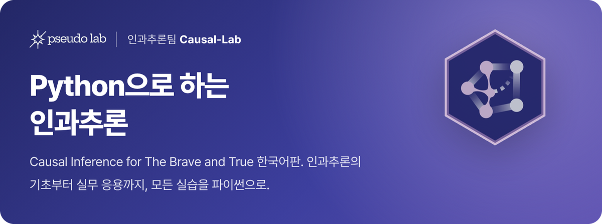

# Python으로 하는 인과추론: 개념부터 실습까지

Matheus Facure의 [Causal Inference for The Brave and True](https://matheusfacure.github.io/python-causality-handbook/landing-page.html) 한국어판입니다.

<p align="center">
  <a href="https://causalinferencelab.github.io/Causal-Inference-with-Python/"></a>
</p>

<p align="center">
  <a href="https://causalinferencelab.github.io/Causal-Inference-with-Python/01-Introduction-To-Causality.html"></a>
  <a href="https://matheusfacure.github.io/python-causality-handbook/landing-page.html"></a>
  <a href="https://product.kyobobook.co.kr/detail/S000212577153"></a>
  <a href="https://www.hanbit.co.kr/product/C0781073345"></a>
</p>

<p align="center">
  <a href="https://github.com/CausalInferenceLab/Causal-Inference-with-Python/stargazers"></a>
  <a href="https://github.com/CausalInferenceLab/Causal-Inference-with-Python/network/members"></a>
  <a href="https://github.com/CausalInferenceLab/Causal-Inference-with-Python/pulls"></a>
  <a href="https://github.com/CausalInferenceLab/Causal-Inference-with-Python/issues"></a>
  <a href="https://github.com/CausalInferenceLab/Causal-Inference-with-Python/graphs/contributors"></a>
  <a href="https://github.com/CausalInferenceLab/Causal-Inference-with-Python/actions/workflows/book.yml"></a>
  <a href="https://doi.org/10.5281/zenodo.4445778"></a>
</p>

**[웹북으로 읽기](https://causalinferencelab.github.io/Causal-Inference-with-Python/)** · [용어집](https://causalinferencelab.github.io/Causal-Inference-with-Python/glossary.html) · [번역 가이드](TRANSLATION_GUIDE.md) · [오류 제보](https://github.com/CausalInferenceLab/Causal-Inference-with-Python/issues)

<br>

## 소개

안녕하세요, [가짜연구소](https://pseudo-lab.com/) 인과추론팀입니다.

『Causal Inference for The Brave and True』는 Nubank의 데이터 과학자 Matheus Facure가 쓴 인과추론 입문서입니다. 잠재적 결과와 무작위 실험 같은 기본 개념에서 시작해 이중차분법, 통제집단합성법, 메타러너, 직교화 머신러닝까지 다루고, 모든 장을 Python 코드로 직접 따라 할 수 있습니다. 인과추론을 처음 공부하는 분에게도, 실무 사례를 찾는 분에게도 좋은 출발점이 되리라 생각해 우리말로 옮겼습니다.

번역은 전문 번역가가 아니라 데이터 분석가, 데이터 과학자, 연구자들이 함께 했습니다. 용어는 『실무로 통하는 인과추론 with 파이썬』(한빛미디어)과 맞췄고, 핵심 용어는 처음 나올 때 영어를 함께 적었습니다. 어색한 문장이나 잘못된 번역을 발견하면 언제든 알려 주세요.

<br>

## 목차

원서 1부와 2부의 25개 장, 부록 5편을 모두 옮겼습니다. 제목을 누르면 웹북의 해당 장으로 바로 이동합니다.

### 1부 인과추론의 기초

| 장 | 제목 | 최초 번역 | 번역 담당자 |
|:-:|---|:-:|---|
| 1 | [인과추론 소개](https://causalinferencelab.github.io/Causal-Inference-with-Python/01-Introduction-To-Causality.html) | 2022-08-20 | [신진수](https://github.com/jsshin2022) |
| 2 | [무작위 실험](https://causalinferencelab.github.io/Causal-Inference-with-Python/02-Randomised-Experiments.html) | 2022-12-04 | [최은희](https://github.com/EunHuiChoi) |
| 3 | [통계 복습: 가장 위험한 수식](https://causalinferencelab.github.io/Causal-Inference-with-Python/03-Stats-Review-The-Most-Dangerous-Equation.html) | 2022-11-10 | [김준영](https://github.com/CptAswadu) |
| 4 | [그래프 인과 모델](https://causalinferencelab.github.io/Causal-Inference-with-Python/04-Graphical-Causal-Models.html) | 2022-11-23 | [김소희](https://github.com/soheekim911) |
| 5 | [선형회귀의 터무니없는 효과](https://causalinferencelab.github.io/Causal-Inference-with-Python/05-The-Unreasonable-Effectiveness-of-Linear-Regression.html) | 2022-11-23 | [남궁민상](https://github.com/wholmesian) |
| 6 | [그룹 회귀와 더미 회귀](https://causalinferencelab.github.io/Causal-Inference-with-Python/06-Grouped-and-Dummy-Regression.html) | 2022-11-05 | [정호재](https://github.com/wjdghwo) |
| 7 | [교란 요인을 넘어서](https://causalinferencelab.github.io/Causal-Inference-with-Python/07-Beyond-Confounders.html) | 2022-11-26 | [김상돈](https://github.com/SANGDONKIM) |
| 8 | [도구변수](https://causalinferencelab.github.io/Causal-Inference-with-Python/08-Instrumental-Variables.html) | 2022-12-04 | [최은희](https://github.com/EunHuiChoi) |
| 9 | [불응과 LATE](https://causalinferencelab.github.io/Causal-Inference-with-Python/09-Non-Compliance-and-LATE.html) | 2022-11-19 | [김성수](https://github.com/fenzhantw) |
| 10 | [매칭](https://causalinferencelab.github.io/Causal-Inference-with-Python/10-Matching.html) | 2022-11-04 | [김상돈](https://github.com/SANGDONKIM) |
| 11 | [성향점수](https://causalinferencelab.github.io/Causal-Inference-with-Python/11-Propensity-Score.html) | 2022-11-11 | [김성수](https://github.com/fenzhantw) |
| 12 | [이중 강건 추정](https://causalinferencelab.github.io/Causal-Inference-with-Python/12-Doubly-Robust-Estimation.html) | 2022-10-28 | [홍성철](https://github.com/chulhongsung) |
| 13 | [이중차분법](https://causalinferencelab.github.io/Causal-Inference-with-Python/13-Difference-in-Differences.html) | 2022-08-27 | [신진수](https://github.com/jsshin2022) |
| 14 | [패널데이터와 고정효과](https://causalinferencelab.github.io/Causal-Inference-with-Python/14-Panel-Data-and-Fixed-Effects.html) | 2022-11-26 | [신진수](https://github.com/jsshin2022) |
| 15 | [통제집단합성법](https://causalinferencelab.github.io/Causal-Inference-with-Python/15-Synthetic-Control.html) | 2022-09-03 | [정호재](https://github.com/wjdghwo) |
| 16 | [회귀 불연속 설계](https://causalinferencelab.github.io/Causal-Inference-with-Python/16-Regression-Discontinuity-Design.html) | 2022-11-22 | [남궁민상](https://github.com/wholmesian) |

### 2부 인과추론의 실무 응용

| 장 | 제목 | 최초 번역 | 번역 담당자 |
|:-:|---|:-:|---|
| 17 | [예측 모델 101](https://causalinferencelab.github.io/Causal-Inference-with-Python/17-Predictive-Models-101.html) | 2023-02-13 | [최은희](https://github.com/EunHuiChoi) |
| 18 | [이질적 처치효과와 개인화](https://causalinferencelab.github.io/Causal-Inference-with-Python/18-Heterogeneous-Treatment-Effects-and-Personalization.html) | 2023-02-20 | [김소희](https://github.com/soheekim911) |
| 19 | [인과 모델 평가](https://causalinferencelab.github.io/Causal-Inference-with-Python/19-Evaluating-Causal-Models.html) | 2023-08-13 | [김성수](https://github.com/fenzhantw) |
| 20 | [플러그 앤 플레이 추정량](https://causalinferencelab.github.io/Causal-Inference-with-Python/20-Plug-and-Play-Estimators.html) | 2023-06-22 | [남궁민상](https://github.com/wholmesian) |
| 21 | [메타러너](https://causalinferencelab.github.io/Causal-Inference-with-Python/21-Meta-Learners.html) | 2023-12-31 | [박병수](https://github.com/Hinterhalter) |
| 22 | [편향 제거/직교화 머신러닝](https://causalinferencelab.github.io/Causal-Inference-with-Python/22-Debiased-Orthogonal-Machine-Learning.html) | 2023-11-03 | [홍성철](https://github.com/chulhongsung) |
| 23 | [효과 이질성과 비선형성](https://causalinferencelab.github.io/Causal-Inference-with-Python/23-Challenges-with-Effect-Heterogeneity-and-Nonlinearity.html) | 2024-01-10 | [임종언](https://github.com/limjongun95) |
| 24 | [이중차분법 사가](https://causalinferencelab.github.io/Causal-Inference-with-Python/24-The-Diff-in-Diff-Saga.html) | 2023-06-26 | [박시온](https://github.com/rockgoat95) |
| 25 | [합성 이중차분법](https://causalinferencelab.github.io/Causal-Inference-with-Python/25-Synthetic-Diff-in-Diff.html) | 2026-10-18 | [신진수](https://github.com/jsshin2022) |

### 부록

| 장 | 제목 | 최초 번역 | 번역 담당자 |
|:-:|---|:-:|---|
| A | [직교화로 편향 제거하기](https://causalinferencelab.github.io/Causal-Inference-with-Python/Debiasing-with-Orthogonalization.html) | 2026-10-18 | [신진수](https://github.com/jsshin2022) |
| B | [성향점수로 편향 제거하기](https://causalinferencelab.github.io/Causal-Inference-with-Python/Debiasing-with-Propensity-Score.html) | 2026-10-18 | [신진수](https://github.com/jsshin2022) |
| C | [예측이 실패할 때](https://causalinferencelab.github.io/Causal-Inference-with-Python/When-Prediction-Fails.html) | 2026-10-18 | [신진수](https://github.com/jsshin2022) |
| D | [예측 지표가 인과 모델에 위험한 이유](https://causalinferencelab.github.io/Causal-Inference-with-Python/Prediction-Metrics-For-Causal-Models.html) | 2026-10-18 | [신진수](https://github.com/jsshin2022) |
| E | [통제집단합성법의 컨포멀 추론](https://causalinferencelab.github.io/Causal-Inference-with-Python/Conformal-Inference-for-Synthetic-Control.html) | 2026-10-18 | [신진수](https://github.com/jsshin2022) |

<br>

## 번역 현황

2026년 10월에 원서 최신판을 기준으로 전체 번역을 다시 다듬었습니다.

- 모든 장을 원문과 문장 단위로 대조해 빠진 문장을 채우고 오역을 바로잡았습니다.
- 원문 개정 내용(18·19장의 elasticity → sensitivity 등)을 반영했습니다.
- 25장과 부록 5편을 새로 옮겼습니다.
- 용어와 문체를 『실무로 통하는 인과추론 with 파이썬』 기준으로 통일했습니다.
- 원문의 오류는 본문과 수식을 고치지 않고 옮긴이 주로 짚었습니다. 뜻이 분명한 오타만 바로잡고 그 사실을 주에 밝혔습니다.

자세한 원칙과 용어표는 [번역 가이드](TRANSLATION_GUIDE.md)에 있습니다.

<br>

## 함께 만들기

- 웹북의 각 장 끝 '의견 나누기'에서 GitHub 계정으로 로그인해 댓글을 남길 수 있습니다. 댓글은 장별로 [GitHub Discussions](https://github.com/CausalInferenceLab/Causal-Inference-with-Python/discussions)에 모입니다.
- 오역, 오탈자, 깨진 수식이나 그림은 [이슈](https://github.com/CausalInferenceLab/Causal-Inference-with-Python/issues)로 알려 주세요.
- 직접 고치고 싶다면 [번역 가이드](TRANSLATION_GUIDE.md)를 읽고 PR을 보내 주세요. 원고는 `causal-inference-for-the-brave-and-true/` 폴더의 노트북입니다.
- 그 밖의 문의는 메인테이너 [신진수](https://github.com/jsshin2022)에게 부탁드립니다.

<br>

## 웹북 빌드

웹북은 [Quarto](https://quarto.org/) Book으로 만듭니다. `main`에 머지되면 GitHub Actions(`.github/workflows/book.yml`)가 빌드해 GitHub Pages에 배포합니다. PR에서는 빌드만 확인하며, 결과물은 Actions의 `book-preview` 아티팩트로 내려받아 볼 수 있습니다.

로컬에서 미리 보려면 Quarto를 설치한 뒤 다음을 실행하세요. 노트북은 다시 실행하지 않고 저장된 출력을 그대로 씁니다.

```bash
pip install jupyter
python book/prepare.py
cd book && quarto preview
```

`book/prepare.py`는 빌드할 때 [번역 가이드](TRANSLATION_GUIDE.md)의 용어표로 웹북의 '용어집' 페이지를 만들고, `book/postrender.py`는 렌더링이 끝난 뒤 웹북 검색 색인(`search-index.json`)을 만듭니다. `book/prepare.py`는 빌드할 때만 장 제목, 수식 표기, 접힌 코드, 옮긴이 주 상자를 책 형식으로 바꿉니다. 그래서 노트북은 원서와 같은 구조로 두면 됩니다.

<br>

## 원서 변경 반영

원서가 바뀌면 GitHub Actions(`Upstream watch`)가 매월 1일 확인해 바뀐 장과 본문 변경을 정리한 이슈를 메인테이너에게 배정합니다. 번역을 고친 PR이 메인테이너 검토를 거쳐 머지되면 웹북에 반영되고 이슈는 자동으로 닫힙니다. 자세한 절차는 [번역 가이드](TRANSLATION_GUIDE.md#5-원서-변경-반영)에 있습니다.

<br>

## 감사의 말

한국어 번역을 흔쾌히 허락해 준 Matheus Facure에게 감사드립니다. 번역과 실습 자료를 함께 만든 인과추론팀 멤버들에게도 고마운 마음을 전합니다.

원서는 Joshua Angrist, Alberto Abadie, Christopher Walters, Miguel Hernán, Jamie Robins 등의 계량경제학 강의를 바탕으로 쓰였고, 많은 아이디어를 미국경제학회(American Economic Association) 강좌에서 가져왔습니다. 원저자가 참고한 자료는 다음과 같습니다.

- [Cross-Section Econometrics](https://www.aeaweb.org/conference/cont-ed/2017-webcasts)
- [Mastering Mostly Harmless Econometrics](https://www.aeaweb.org/conference/cont-ed/2020-webcasts)
- [Mostly Harmless Econometrics](https://www.mostlyharmlesseconometrics.com/)
- [Mastering 'Metrics](https://www.masteringmetrics.com/)
- [Causal Inference: What If](https://www.hsph.harvard.edu/miguel-hernan/causal-inference-book/)

<br>

## 라이선스

[MIT License](LICENSE)를 따릅니다.
