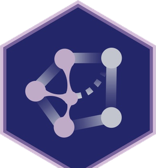

```{=html}
<div class="hero">
  
  <div class="hero-brand">
    
    <span class="hero-brand-divider"></span>
    <span class="hero-brand-team">인과추론팀 <b>Causal-Lab</b></span>
  </div>
  <p class="hero-title">Python으로 하는<br>인과추론</p>
  <p class="hero-sub">Causal Inference for The Brave and True 한국어판. 인과추론의 기초부터 실무 응용까지, 모든 실습을 파이썬으로.</p>
  <div class="hero-actions">
    <a class="primary" href="01-Introduction-To-Causality.html">1장부터 읽기</a>
    <a class="ghost" href="https://github.com/CausalInferenceLab/Causal-Inference-with-Python">GitHub</a>
    <a class="ghost" href="https://matheusfacure.github.io/python-causality-handbook/landing-page.html">원서 보기</a>
  </div>
</div>
```

# 들어가며 {.unnumbered}

안녕하세요, [가짜연구소](https://pseudo-lab.com/) [신진수](https://www.linkedin.com/in/jinsoo-shin-436060162/)입니다.

이 책은 Matheus Facure의 『Causal Inference for The Brave and True』를 가짜연구소 인과추론팀이 원저자의 동의를 받아 우리말로 옮긴 것입니다. 인과추론은 "이 정책이, 이 할인이, 이 기능이 정말 효과가 있었을까?"라는 질문에 데이터로 답하는 방법입니다. 그런데 막상 공부하려고 하면 한국어로 된 자료, 특히 코드와 함께 손으로 따라 해 볼 수 있는 자료가 많지 않습니다. 이 책이 그 빈자리를 채우는 길잡이가 되면 좋겠습니다.

원서는 가볍지만 엄밀하게 효과 추정을 배우는 책입니다. 모든 실습을 파이썬으로 하고, 저자가 찾을 수 있는 밈은 최대한 넣었습니다. 딱딱한 교과서보다는 옆자리 동료가 설명해 주는 느낌으로 읽어 주세요.

## 이 책의 구성

원서의 25개 장과 부록 5편을 모두 옮겼습니다.

```{=html}
<div class="toc-cards">
  <a class="card-item" href="01-Introduction-To-Causality.html" style="text-decoration:none">
    <div class="card-label">1부 · 1–16장</div>
    <div class="card-title">인과추론의 기초</div>
    <p>잠재적 결과, 인과 그래프, 편향부터 회귀분석, 도구변수, 매칭, 성향점수, 이중차분법, 통제집단합성법, 회귀 불연속 설계까지.</p>
  </a>
  <a class="card-item" href="17-Predictive-Models-101.html" style="text-decoration:none">
    <div class="card-label">2부 · 17–25장</div>
    <div class="card-title">인과추론의 실무 응용</div>
    <p>이질적 처치효과와 개인화, 인과 모델 평가, 메타러너, 이중 머신러닝, 이중차분법의 최근 논의와 합성 이중차분법.</p>
  </a>
  <a class="card-item" href="Debiasing-with-Orthogonalization.html" style="text-decoration:none">
    <div class="card-label">부록 · 5편</div>
    <div class="card-title">더 깊이 보기</div>
    <p>직교화와 성향점수로 편향 제거하기, 예측이 실패하는 경우, 예측 지표의 함정, 컨포멀 추론.</p>
  </a>
</div>
```

1부는 학계에서 자리 잡은 내용이라 인과적 질문을 다룰 때 기댈 수 있는 튼튼한 토대가 됩니다. 2부는 저자가 핀테크 회사에서 쌓은 실무 경험에서 나온 내용이 많아 더 실험적이고, 그만큼 현업에 바로 가져다 쓸 거리가 많습니다.

## 이렇게 읽어 주세요

각 장은 원서의 주피터 노트북을 그대로 옮긴 것이라 코드와 출력이 원서와 같습니다. 노트북 파일은 [GitHub 저장소](https://github.com/CausalInferenceLab/Causal-Inference-with-Python/tree/main/causal-inference-for-the-brave-and-true)에서 내려받아 직접 실행해 볼 수 있습니다. 그래프를 그리는 코드처럼 길어서 접어 둔 셀은 **코드**를 눌러 펼치면 됩니다.

용어는 같은 저자의 책을 옮긴 『실무로 통하는 인과추론 with 파이썬』(한빛미디어)과 맞췄습니다. 두 책을 함께 보셔도 용어가 헷갈리지 않습니다. 번역 원칙과 용어표는 [번역 가이드](https://github.com/CausalInferenceLab/Causal-Inference-with-Python/blob/main/TRANSLATION_GUIDE.md)에 정리해 두었습니다.

## 함께 만들어 주세요

인과추론팀은 전문 번역가가 아니라 데이터 분석가, 데이터 과학자, 연구자로 이루어져 있습니다. 어색하거나 틀린 부분이 보이면 [이슈](https://github.com/CausalInferenceLab/Causal-Inference-with-Python/issues)로 알려 주시거나 직접 PR을 보내 주세요. 도움이 되었다면 [GitHub 스타](https://github.com/CausalInferenceLab/Causal-Inference-with-Python)로 응원해 주시면 큰 힘이 됩니다.

한국어 번역에 흔쾌히 동의해 준 Matheus Facure와, 번역과 실습 자료를 함께 만든 인과추론팀 멤버들에게 감사드립니다.

## 원저자의 감사의 말

> 이 시리즈 전체를 Joshua Angrist, Alberto Abadie, Christopher Walters의 훌륭한 계량경제학 강의에 바치는 헌사로 생각합니다. 1부의 아이디어는 대부분 이들이 미국경제학회(American Economic Association)에서 한 강의에서 가져왔습니다. Angrist의 책들은 계량경제학이 아주 유용할 뿐 아니라 무척 재미있다는 것을 알려 주었고, Miguel Hernan과 Jamie Robins의 책은 가장 까다로운 인과적 질문 앞에서 늘 믿고 기댄 동반자였습니다.

- [Mastering Mostly Harmless Econometrics](https://www.aeaweb.org/conference/cont-ed/2020-webcasts) · [Cross-Section Econometrics](https://www.aeaweb.org/conference/cont-ed/2017-webcasts)
- [Mostly Harmless Econometrics](https://www.mostlyharmlesseconometrics.com/) · [Mastering 'Metrics](https://www.masteringmetrics.com/)
- [Causal Inference: What If](https://miguelhernan.org/whatifbook)

원서는 누구나 무료로 볼 수 있는 오픈소스 자료입니다. 원서가 도움이 되었다면 저자의 [Patreon](https://www.patreon.com/causal_inference_for_the_brave_and_true)을 후원하거나 [원서 저장소에 스타](https://github.com/matheusfacure/python-causality-handbook/stargazers)를 남겨 주세요.
